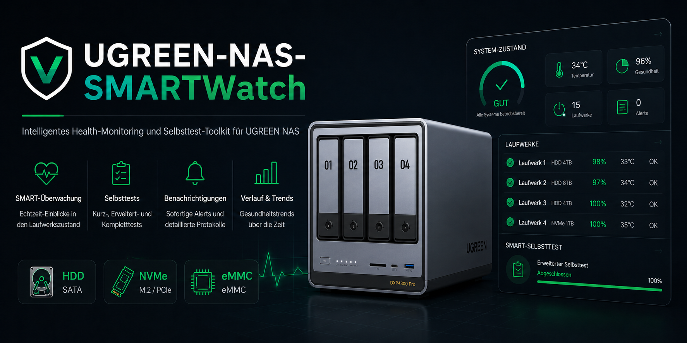
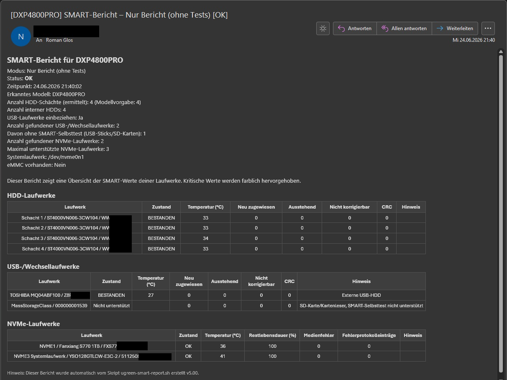
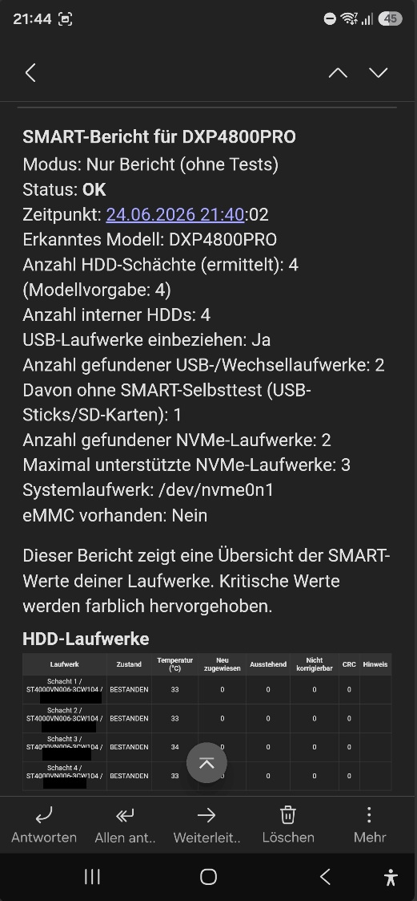
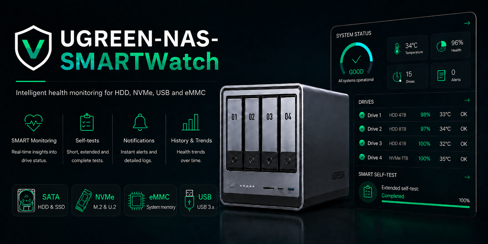
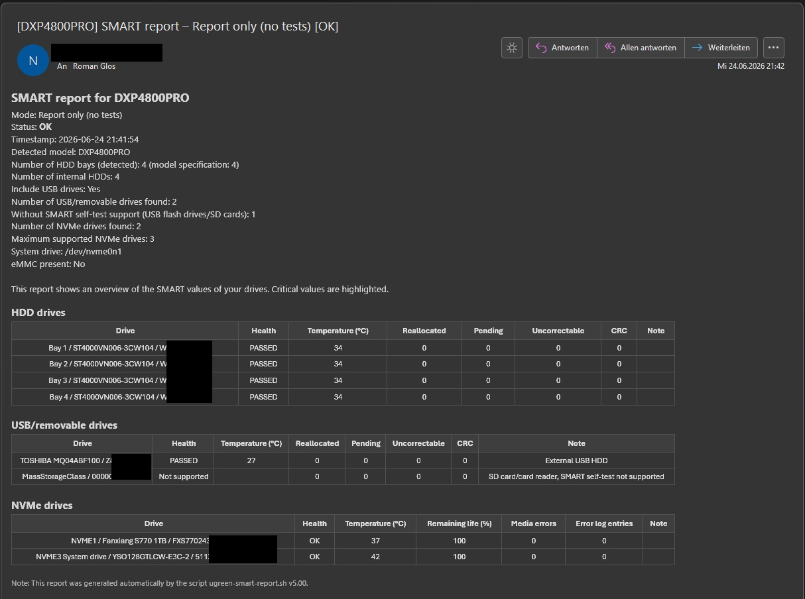
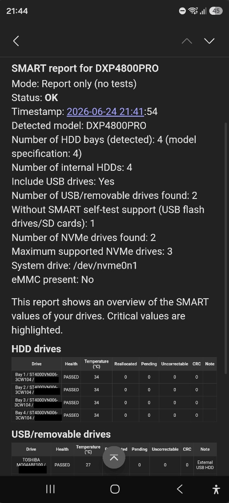

# UGREEN-NAS-SMARTWatch

[](https://github.com/Railsimulatornet/UGREEN-NAS-SMARTWatch/actions/workflows/quality.yml)
[](LICENSE)



[Deutsch](#deutsch) · [English](#english)

## Deutsch

SMARTWatch liest Laufwerks- und Gesundheitsdaten auf UGREEN NAS mit UGOS aus. Das Bash-Skript prüft HDD- und NVMe-SMART-Werte, kann unterstützte Selbsttests starten und erstellt einen Outlook-freundlichen HTML-Report per E-Mail. USB-Laufwerke und eMMC-Zustandsprüfungen sind zusätzlich einstellbar.

### Funktionen

- SMART-Berichte für HDD- und NVMe-Laufwerke; USB-Laufwerke optional einbeziehen.
- Wöchentlicher Kurztest und monatlicher Langtest.
- eMMC-Erkennung, Zustandsprüfung und optionaler Lesetest.
- Erkennung festhängender NVMe-Selbsttests mit einstellbaren Wartezeiten.
- Deutsch und Englisch für Konsole, Protokoll und E-Mail über `LANGUAGE`.
- Cron-Betrieb mit festen Pfaden und Schutz vor überlappenden geplanten Aufrufen.
- Hilfeaufruf ohne Root-Rechte, Logzugriffe oder Laufwerksprüfung.

### Voraussetzungen

- UGREEN NAS mit UGOS.
- Root-Rechte für die Laufwerksprüfung und den regulären Skriptbetrieb; für `--help` nicht erforderlich.
- Python 3 unter `/usr/bin/python3`.
- `smartctl` aus Smartmontools; Selbsttests müssen vom jeweiligen Laufwerk unterstützt werden.
- SMTP-Zugang für den Mailversand.
- Für das Cron-Beispiel: `/usr/bin/flock`.

### Schnellstart

1. Lade das aktuelle Paket unter [Releases](https://github.com/Railsimulatornet/UGREEN-NAS-SMARTWatch/releases/latest) herunter.
2. Kopiere den **Inhalt** des Ordners `SmartWatch/` auf dein NAS, zum Beispiel nach `/volume2/NASAdmin/Skripte/SmartWatch/`.
3. Verbinde dich per SSH und bereite die Dateien vor:

```bash
sudo -i
cd /volume2/NASAdmin/Skripte/SmartWatch
cp smart-report.env.example smart-report.env
chmod +x ugreen-smart-report.sh
```

4. Bearbeite `smart-report.env`. Setze Sprache, Logpfad sowie die SMTP-Daten und Empfänger passend zu deiner Umgebung.
5. Prüfe den Mailversand und erstelle anschließend einen Bericht ohne neue Selbsttests:

```bash
bash ./ugreen-smart-report.sh --test-mail
bash ./ugreen-smart-report.sh --report-only
```

Alle Pfade sind Beispiele und können an dein Volume angepasst werden.

### Nutzung

| Aufruf | Verhalten |
| --- | --- |
| `bash ./ugreen-smart-report.sh --help` | Hilfe anzeigen; auch `-h` und `--` werden akzeptiert. |
| `bash ./ugreen-smart-report.sh --test-mail` | Nur eine Testmail senden. |
| `bash ./ugreen-smart-report.sh --report-only` | Bericht erzeugen, ohne neue SMART-Selbsttests zu starten. |
| `bash ./ugreen-smart-report.sh --weekly-short` | Kurztests starten und anschließend berichten. |
| `bash ./ugreen-smart-report.sh --monthly-long` | Langtests starten und anschließend berichten. |

**Ohne Parameter verhält sich das Skript wie `--monthly-long`.** Verwende für einen reinen Bericht deshalb ausdrücklich `--report-only`.

Wöchentliche und monatliche Testläufe brechen ab, wenn bereits ein SMART-Test läuft. Mit `ABORT_RUNNING_TESTS_BEFORE_START=true` kannst du stattdessen den Abbruch laufender Tests vor einem neuen Lauf aktivieren.

### Konfiguration

Die vollständige Vorlage ist [SmartWatch/smart-report.env.example](SmartWatch/smart-report.env.example). Die aktive Konfiguration heißt `smart-report.env` und liegt neben dem Skript.

| Bereich | Einstellungen |
| --- | --- |
| Sprache | `LANGUAGE=de` oder `LANGUAGE=en`. |
| NAS-Anzeige | `NAS_CUSTOM_NAME` ergänzt den Namen; `NAS_MODEL_OVERRIDE` überschreibt bei Bedarf die automatische Modellerkennung. Die unterstützten Kennungen stehen in der Vorlage. |
| Logs | `LOG_DIR`, `LOG_FILE` und `LOG_RETENTION_DAYS`. Vorgabe: `/volume2/NASAdmin/Logs/SmartWatch`, Aufbewahrung 30 Tage. |
| SMTP-Zugang | `SMTP_SERVER`, `SMTP_PORT`, `SMTP_USER`, `SMTP_PASS`, `MAIL_FROM` und `MAIL_TO`. |
| Mailverschlüsselung | `SMTP_USE_TLS=true` und `SMTP_USE_SSL=false` für STARTTLS; für implizites TLS die Werte passend zum Server umstellen. |
| USB | `INCLUDE_USB_DRIVES` steuert die Einbeziehung von USB-Laufwerken. |
| eMMC | `EMMC_ENABLE_CHECK` aktiviert die Zustandsprüfung, `EMMC_ENABLE_READTEST` den optionalen Lesetest. |
| NVMe-Wartezeiten | `NVME_MAX_WAIT_SHORT_MIN=15` und `NVME_MAX_WAIT_LONG_MIN=240` begrenzen die Wartezeit auf Selbsttests. |
| NVMe-Stillstand | `NVME_STALL_DETECTION` und die zugehörigen `NVME_STALL_*`-Werte steuern den früheren Abbruch bei unverändertem Fortschritt. |
| Bereits laufende Tests | `ABORT_RUNNING_TESTS_BEFORE_START=false` lässt bestehende Tests unangetastet und bricht den neuen Testlauf ab. |
| Herunterfahren | `SHUTDOWN_AFTER_LONG=false` lässt das NAS nach dem monatlichen Langtest eingeschaltet. |

Empfohlener Skriptpfad: `/volume2/NASAdmin/Skripte/SmartWatch`. Weitere Diagnoseoptionen und die weiterhin akzeptierten älteren NVMe-Wartezeitvariablen stehen in der Skripthilfe.

### Erkannte UGREEN-Modelle

Die folgenden Modellkennungen sind im Skript hinterlegt:

| Serie | Modelle |
| --- | --- |
| DH | DH2300, DH4300 Plus |
| DX / iDX | DX4700, iDX6011, iDX6011 Pro |
| DXP 2800 / 4800 | DXP2800, DXP2800 GT, DXP4800, DXP4800 Plus, DXP4800 Pro, DXP4800 GT, DXP480T Plus |
| DXP 6800 / 8800 | DXP6800 Plus, DXP6800 Pro, DXP6800 Ultra, DXP8800 Plus, DXP8800 Pro, DXP8800 Ultra |

Für die GT-Serie berücksichtigt die Erkennung auch U.2-NVMe-Laufwerke. Beim DXP4800 GT sind physische Bezeichnungen für U.2-Schacht 1 und 2 hinterlegt.

Andere UGREEN-Modelle können über die allgemeine Laufwerkserkennung funktionieren, sind damit aber nicht ausdrücklich verifiziert. Rückmeldungen zu weiteren Modellen sind willkommen.

### Zeitgesteuerte Tests

Öffne die Root-Crontab mit `crontab -e`. Das Beispiel startet montags um 03:00 Uhr Kurztests und am ersten Tag jedes Monats um 04:15 Uhr Langtests. `flock` verhindert eine Überschneidung dieser geplanten Aufrufe.

```cron
SHELL=/bin/bash
PATH=/usr/local/sbin:/usr/local/bin:/usr/sbin:/usr/bin:/sbin:/bin

0 3 * * 1 /usr/bin/flock -n /tmp/smarthealth.lock /bin/bash /volume2/NASAdmin/Skripte/SmartWatch/ugreen-smart-report.sh --weekly-short >/dev/null 2>&1
15 4 1 * * /usr/bin/flock -n /tmp/smarthealth.lock /bin/bash /volume2/NASAdmin/Skripte/SmartWatch/ugreen-smart-report.sh --monthly-long >/dev/null 2>&1
```

### Aktualisierung

Warte einen laufenden Test ab und pausiere geplante Aufrufe während des Austauschs. Sichere Skript und Konfiguration, ersetze `ugreen-smart-report.sh` aus dem aktuellen Paket und vergleiche neue Optionen mit der ENV-Vorlage. Behalte deine aktive `smart-report.env`. Prüfe danach Hilfe, Testmail und Bericht.

### Screenshots

| Outlook | Mobile Ansicht |
| --- | --- |
|  |  |

Weitere Projektbilder und beide Sprachfassungen liegen unter [Screens/](Screens/).

### Projektstruktur und Dokumentation

| Pfad | Inhalt |
| --- | --- |
| [SmartWatch/ugreen-smart-report.sh](SmartWatch/ugreen-smart-report.sh) | Laufwerksprüfung, Selbsttests und Mailbericht. |
| [SmartWatch/smart-report.env.example](SmartWatch/smart-report.env.example) | Konfigurationsvorlage. |
| [UGREEN_SMARTWatch_Manual_DE-EN_v5.00.pdf](UGREEN_SMARTWatch_Manual_DE-EN_v5.00.pdf) | Ausführliches Handbuch auf Deutsch und Englisch. |
| [RELEASE_NOTES_v5.00.md](RELEASE_NOTES_v5.00.md) | Versionshinweise zu v5.00. |

Aktuelle Skriptversion: **v5.00.1**. Die bestehenden Handbuch- und Versionshinweisdateien behalten ihre ursprünglichen Namen.

Die Änderungen in v5.00 umfassen zusätzliche GT-/Ultra-Modellkennungen, U.2-Erkennung und Schachtzuordnung, verbesserte Modellnormalisierung und NVMe-Anzeige sowie getrennte deutsche und englische Ausgaben. Übersprungene eMMC-Lesetests und Fortschrittsmeldungen vor und nach vollständigen Lesetests werden genauer dargestellt.

### Lizenz

Dieses Projekt steht unter der [MIT-Lizenz](LICENSE).

Copyright © 2026 **Roman Glos**.

## English



SMARTWatch reads drive and health information on UGREEN NAS systems running UGOS. The Bash script checks HDD and NVMe SMART data, can start supported self-tests and sends an Outlook-friendly HTML report by email. USB drives and eMMC health checks are configurable additions.

### Features

- SMART reports for HDD and NVMe drives, with optional USB-drive inclusion.
- Weekly short tests and monthly long tests.
- eMMC detection, health checks and an optional read test.
- Detection of stalled NVMe self-tests with configurable wait times.
- German and English console output, logs and emails through `LANGUAGE`.
- Cron operation with explicit paths and protection against overlapping scheduled runs.
- Help output without root privileges, log access or drive checks.

### Requirements

- UGREEN NAS running UGOS.
- Root privileges for drive checks and normal script operation; not required for `--help`.
- Python 3 at `/usr/bin/python3`.
- `smartctl` from Smartmontools; the respective drive must support self-tests.
- SMTP access for email delivery.
- For the cron example: `/usr/bin/flock`.

### Quick start

1. Download the current package from [Releases](https://github.com/Railsimulatornet/UGREEN-NAS-SMARTWatch/releases/latest).
2. Copy the **contents** of the `SmartWatch/` folder to your NAS, for example to `/volume2/NASAdmin/Skripte/SmartWatch/`.
3. Connect over SSH and prepare the files:

```bash
sudo -i
cd /volume2/NASAdmin/Skripte/SmartWatch
cp smart-report.env.example smart-report.env
chmod +x ugreen-smart-report.sh
```

4. Edit `smart-report.env`. Set the language, log path, SMTP details and recipients for your environment. Use `LANGUAGE=en` for English output.
5. Check email delivery, then generate a report without starting new self-tests:

```bash
bash ./ugreen-smart-report.sh --test-mail
bash ./ugreen-smart-report.sh --report-only
```

All paths are examples and can be adjusted to your volume.

### Usage

| Command | Behavior |
| --- | --- |
| `bash ./ugreen-smart-report.sh --help` | Show help; `-h` and `--` are also accepted. |
| `bash ./ugreen-smart-report.sh --test-mail` | Send a test email only. |
| `bash ./ugreen-smart-report.sh --report-only` | Generate a report without starting new SMART self-tests. |
| `bash ./ugreen-smart-report.sh --weekly-short` | Start short tests and report afterwards. |
| `bash ./ugreen-smart-report.sh --monthly-long` | Start long tests and report afterwards. |

**Without parameters, the script behaves like `--monthly-long`.** Explicitly use `--report-only` when you only want a report.

Weekly and monthly test runs stop if a SMART test is already running. Setting `ABORT_RUNNING_TESTS_BEFORE_START=true` instead enables cancellation of running tests before a new run.

### Configuration

The complete template is [SmartWatch/smart-report.env.example](SmartWatch/smart-report.env.example). The active configuration is named `smart-report.env` and sits beside the script.

| Area | Settings |
| --- | --- |
| Language | `LANGUAGE=de` or `LANGUAGE=en`. |
| NAS display | `NAS_CUSTOM_NAME` adds a custom name; `NAS_MODEL_OVERRIDE` can override automatic model detection. Supported identifiers are listed in the template. |
| Logs | `LOG_DIR`, `LOG_FILE` and `LOG_RETENTION_DAYS`. Default directory: `/volume2/NASAdmin/Logs/SmartWatch`, with 30-day retention. |
| SMTP access | `SMTP_SERVER`, `SMTP_PORT`, `SMTP_USER`, `SMTP_PASS`, `MAIL_FROM` and `MAIL_TO`. |
| Email encryption | `SMTP_USE_TLS=true` and `SMTP_USE_SSL=false` for STARTTLS; adjust the values to the server when using implicit TLS. |
| USB | `INCLUDE_USB_DRIVES` controls USB-drive inclusion. |
| eMMC | `EMMC_ENABLE_CHECK` enables health checks; `EMMC_ENABLE_READTEST` enables the optional read test. |
| NVMe wait times | `NVME_MAX_WAIT_SHORT_MIN=15` and `NVME_MAX_WAIT_LONG_MIN=240` limit the wait for self-tests. |
| NVMe stalls | `NVME_STALL_DETECTION` and the associated `NVME_STALL_*` settings control earlier cancellation when progress stops changing. |
| Tests already running | `ABORT_RUNNING_TESTS_BEFORE_START=false` leaves existing tests untouched and cancels the new test run. |
| Shutdown | `SHUTDOWN_AFTER_LONG=false` keeps the NAS running after the monthly long test. |

Recommended script path: `/volume2/NASAdmin/Skripte/SmartWatch`. Additional diagnostic settings and accepted legacy NVMe wait-time variables are documented in the script's help output.

### Recognized UGREEN models

The following model identifiers are defined in the script:

| Series | Models |
| --- | --- |
| DH | DH2300, DH4300 Plus |
| DX / iDX | DX4700, iDX6011, iDX6011 Pro |
| DXP 2800 / 4800 | DXP2800, DXP2800 GT, DXP4800, DXP4800 Plus, DXP4800 Pro, DXP4800 GT, DXP480T Plus |
| DXP 6800 / 8800 | DXP6800 Plus, DXP6800 Pro, DXP6800 Ultra, DXP8800 Plus, DXP8800 Pro, DXP8800 Ultra |

Detection also covers U.2 NVMe drives for the GT series. Physical labels for U.2 Bay 1 and Bay 2 are defined for the DXP4800 GT.

Other UGREEN models may work through generic drive detection, but that does not mean they have been explicitly verified. Feedback on additional models is welcome.

### Scheduled tests

Open the root crontab with `crontab -e`. This example starts short tests on Mondays at 03:00 and long tests on the first day of each month at 04:15. `flock` prevents these scheduled commands from overlapping.

```cron
SHELL=/bin/bash
PATH=/usr/local/sbin:/usr/local/bin:/usr/sbin:/usr/bin:/sbin:/bin

0 3 * * 1 /usr/bin/flock -n /tmp/smarthealth.lock /bin/bash /volume2/NASAdmin/Skripte/SmartWatch/ugreen-smart-report.sh --weekly-short >/dev/null 2>&1
15 4 1 * * /usr/bin/flock -n /tmp/smarthealth.lock /bin/bash /volume2/NASAdmin/Skripte/SmartWatch/ugreen-smart-report.sh --monthly-long >/dev/null 2>&1
```

### Updating

Wait for any running test to finish and pause scheduled commands while replacing files. Back up the script and configuration, replace `ugreen-smart-report.sh` from the current package and compare new options against the ENV template. Keep your active `smart-report.env`. Then check help output, the test email and a report.

### Screenshots

| Outlook | Mobile view |
| --- | --- |
|  |  |

Further project images and both language versions are available under [Screens/](Screens/).

### Project structure and documentation

| Path | Contents |
| --- | --- |
| [SmartWatch/ugreen-smart-report.sh](SmartWatch/ugreen-smart-report.sh) | Drive checks, self-tests and email reporting. |
| [SmartWatch/smart-report.env.example](SmartWatch/smart-report.env.example) | Configuration template. |
| [UGREEN_SMARTWatch_Manual_DE-EN_v5.00.pdf](UGREEN_SMARTWatch_Manual_DE-EN_v5.00.pdf) | Detailed German and English manual. |
| [RELEASE_NOTES_v5.00.md](RELEASE_NOTES_v5.00.md) | Release notes for v5.00. |

Current script version: **v5.00.1**. The existing manual and release-note files keep their original names.

The v5.00 changes include additional GT/Ultra model identifiers, U.2 detection and bay mapping, improved model normalization and NVMe display, and separate German and English output. Skipped eMMC read tests and progress messages before and after full read tests are displayed more precisely.

### License

This project is licensed under the [MIT License](LICENSE).

Copyright © 2026 **Roman Glos**.

